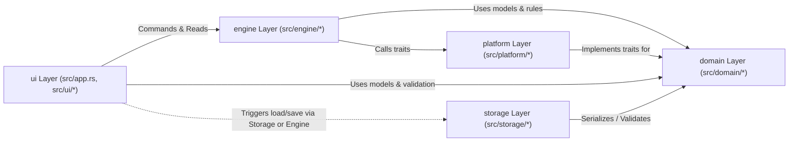

# Architecture (`ctt-app`)

This document explicitly distinguishes between the **current implemented codebase** and the **target layered architecture** defined for upcoming development.

---

## 1. Current Implemented Architecture

`ctt-app` follows the four-layer architecture separating UI (`ui/`, `src/main.rs`, `src/app.rs`), pure domain logic (`src/domain/*`), runtime remapping engine (`src/engine/*`), platform abstractions & test mocks (`src/platform/*`), and profile persistence (`src/storage/*`):

- [ui/app.slint](ui/app.slint) — Declarative Slint UI definition defining `AppWindow` with sidebar navigation (`Tổng quan`, `Macros`, `Binding`), view routing, and persistent [ui/components/status_bar.slint](ui/components/status_bar.slint).
- [ui/components/home.slint](ui/components/home.slint) — Overview page, profile selector, and binding summary table.
- [ui/components/macros_view.slint](ui/components/macros_view.slint) & [ui/components/macro_io_modal.slint](ui/components/macro_io_modal.slint) — Multi-track NLE Create Macro UI (Hybrid Light Slate/Indigo + Dark Studio timeline canvas) and `import.md` sequence import/export modal.
- [ui/components/binding_view.slint](ui/components/binding_view.slint) — Interactive key-binding editor allowing any standard keyboard key (`123` keys) to be bound to any keyboard key, modifier combo, mouse button, mouse wheel direction, or disabled state.
- [build.rs](build.rs) — Build script invoking `slint_build::compile("ui/app.slint")`.
- [src/lib.rs](src/lib.rs) — Library root exporting `app`, `domain`, `engine`, `macro_editor`, `platform`, and `storage`.
- [src/main.rs](src/main.rs) — Instantiates `AppWindow`, populates key/mouse catalogs, binds event callbacks, drives the 60 FPS macro animation timer, and runs the Slint event loop (`#![cfg_attr(not(debug_assertions), windows_subsystem = "windows")]` in release builds).
- [src/app.rs](src/app.rs) & [src/macro_editor.rs](src/macro_editor.rs) — `CttApp` coordinator and `MacroEditorState` bridging Slint UI state with domain profiles, multi-track NLE timeline interactions, rule validation, and `RemapEngine`.
- `src/domain/` (`keys.rs`, `mapping.rs`, `validation.rs`, `profile.rs`, `config.rs`, `macros.rs`, `macro_io.rs`) — Exhaustive `KeyboardKey` catalog (`123` standard keys + `OemScanCode`), `MouseButton`/`MouseWheel`, `MappingTarget`, `CompiledMappingTable` (`O(1)` lookup), conflict/swap/chain/safety validation, `Profile` models, Multi-Track NLE `Clip`/`MacroDefinition` models & compiler, and `import.md` parser/exporter.
- `src/engine/` (`remapper.rs`, `macro_player.rs`, `runtime.rs`, `command.rs`) — `RemapEngine` press/hold/auto-repeat/release state machine, background `MacroPlayer` worker thread (monotonic timing, `Condvar` cancellation, loop safety floor, reverse-order key release), and `InputDispatcher` / `LiveAutomationBackend` unifying live hooks, key remaps, macro triggers, capture suspension, and Emergency Stop.
- `src/platform/` (`mod.rs`, `mock.rs`, `windows/{ffi.rs, hook.rs, keymap.rs, synth.rs}`) — `InputSynthesizer` and `InputInterceptor` traits, `MockInputSynthesizer`, bidirectional Win32 keymap table, and live zero-dependency Win32 `SetWindowsHookExW` (`WH_KEYBOARD_LL` + `WH_MOUSE_LL`), `SendInput` (tagged with `CTT_SYNTHETIC_TAG`), and `timeBeginPeriod(1)` FFI bindings (`ADR-003`).
- `src/storage/` (`profile_store.rs`, `error.rs`) — Schema-versioned profile serialization, directory load/save/delete, active profile state persistence (`app_state.cfg`), and atomic file writes (temp file + `sync_all` + rename).

---

## 2. Target Layered Architecture (Planned)

As features are implemented, the codebase will follow a strict four-layer separation so business rules remain unit-testable and decoupled from both `egui` and OS APIs:

### Layer Responsibilities

| Layer | Planned Location | Responsibility | Forbidden Dependencies |
| :--- | :--- | :--- | :--- |
| **UI** | `ui/*.slint`, `src/app.rs`, `src/main.rs` | Slint declarative UI views, widgets, key-capture prompts, view-state property bindings, status indicators. | Direct OS hook APIs, blocking disk I/O, macro timing loops. |
| **Domain** | `src/domain/*` | Pure Rust types and rules for Macros, Key Mappings, Profiles, App Config, validation, and conflict/cycle detection. | `slint`, `windows`/`winapi`, filesystem I/O. |
| **Engine** | `src/engine/*` | Background worker orchestration, macro playback timing/cancellation, recording coordinator, compiled remap dispatch. | Slint UI thread blocking (interacts via channel messages & event dispatch). |
| **Platform** | `src/platform/*` | OS-specific input hooks, event synthesis, synthetic-event tagging, monotonic timers, RAII hook cleanup, plus test fakes. | UI state, config persistence. |
| **Storage** | `src/storage/*` | Schema-versioned serialization/deserialization, atomic config/profile writes, macro import/export. | `slint`, OS hooks. |

---

## 3. Concurrency & Data Flow (Target Design)

To keep the `egui` UI responsive at 60+ FPS while honoring strict OS input hook latency budgets:

1. **Main UI Thread (`eframe`)**: Renders `CttApp::update`, reads lightweight state snapshots from the engine, and dispatches user commands (e.g., `StartMacro`, `StopAll`, `SwitchProfile`, `StartRecording`) over bounded channels. Never sleeps or blocks.
2. **OS Input Hook Thread (Platform)**: Receives raw OS keyboard/mouse events, ignores self-synthesized tagged events, performs fast `O(1)` lookup (for remaps) or non-blocking channel send (for recording/triggers), and returns immediately.
3. **Engine / Playback Worker Thread**: Executes macro step sequences and interruptible delays, tracks pressed virtual keys for guaranteed `Up` release, monitors atomic cancellation / emergency-stop tokens, and notifies the UI thread via `egui::Context::request_repaint()` on state transitions.

---

## 4. Error Handling & Testing Boundaries

- **Error Handling**: Typed domain/boundary error enums (`MacroError`, `MappingError`, `StorageError`, `PlatformError`) returned via `Result`. No `.unwrap()` or `.expect()` in runtime/hook paths; FFI hook callbacks must guard against Rust panic unwinding.
- **Testing Boundaries**:
  - `domain` modules and `storage` serialization round-trips must pass under `cargo test` with zero GUI or OS dependencies.
  - `engine` playback, cancellation, and loop-prevention tests must run against an in-memory mock `Platform` trait implementation rather than injecting real OS events.
  - Platform Windows hooks require manual hardware smoke testing checklists (see [DEVELOPMENT_GUIDE.md](DEVELOPMENT_GUIDE.md)).
