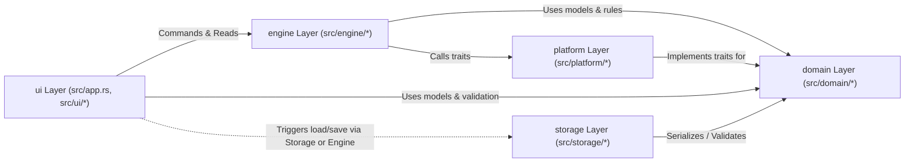

# Architecture (`ctt-app`)

This document explicitly distinguishes between the **current implemented codebase** and the **target layered architecture** defined for upcoming development.

---

## 1. Current Implemented Architecture

At present, `ctt-app` consists solely of a single-crate Rust binary with two source files:

- [ui/app.slint](ui/app.slint) — Declarative Slint UI definition defining `AppWindow` with window sizing, top bar (`Quit`), search input, counter demonstration, peripheral management overview, and status bar.
- [build.rs](build.rs) — Build script invoking `slint_build::compile("ui/app.slint")`.
- [src/main.rs](src/main.rs) — Instantiates `AppWindow`, binds event callbacks (`on_increment_counter`, `on_quit_requested`), links domain state, and runs the Slint event loop. Sets `#![cfg_attr(not(debug_assertions), windows_subsystem = "windows")]` for release builds.
- [src/app.rs](src/app.rs) — Defines `CttApp` state struct (`search_query: String`, `counter: i32`, `status: String`) with unit tests.

No domain, engine, OS hook, persistence, or test modules exist yet.

---

## 2. Target Layered Architecture (Planned)

As features are implemented, the codebase will follow a strict four-layer separation so business rules remain unit-testable and decoupled from both `egui` and OS APIs:

### Layer Responsibilities

| Layer | Planned Location | Responsibility | Forbidden Dependencies |
| :--- | :--- | :--- | :--- |
| **UI** | `ui/*.slint`, `src/app.rs`, `src/main.rs` | Slint declarative UI views, widgets, key-capture prompts, view-state property bindings, status indicators. | Direct OS hook APIs, blocking disk I/O, macro timing loops. |
| **Domain** | `src/domain/*` | Pure Rust types and rules for Macros, Key Mappings, Profiles, App Config, validation, and conflict/cycle detection. | `slint`, `windows`/`winapi`, filesystem I/O. |
| **Engine** | `src/engine/*` | Background worker orchestration, macro playback timing/cancellation, recording coordinator, compiled remap dispatch. | Slint UI thread blocking (interacts via channel messages & event dispatch). |
| **Platform** | `src/platform/*` | OS-specific input hooks, event synthesis, synthetic-event tagging, monotonic timers, RAII hook cleanup, plus test fakes. | UI state, config persistence. |
| **Storage** | `src/storage/*` | Schema-versioned serialization/deserialization, atomic config/profile writes, macro import/export. | `slint`, OS hooks. |

---

## 3. Concurrency & Data Flow (Target Design)

To keep the `egui` UI responsive at 60+ FPS while honoring strict OS input hook latency budgets:

1. **Main UI Thread (`eframe`)**: Renders `CttApp::update`, reads lightweight state snapshots from the engine, and dispatches user commands (e.g., `StartMacro`, `StopAll`, `SwitchProfile`, `StartRecording`) over bounded channels. Never sleeps or blocks.
2. **OS Input Hook Thread (Platform)**: Receives raw OS keyboard/mouse events, ignores self-synthesized tagged events, performs fast `O(1)` lookup (for remaps) or non-blocking channel send (for recording/triggers), and returns immediately.
3. **Engine / Playback Worker Thread**: Executes macro step sequences and interruptible delays, tracks pressed virtual keys for guaranteed `Up` release, monitors atomic cancellation / emergency-stop tokens, and notifies the UI thread via `egui::Context::request_repaint()` on state transitions.

---

## 4. Error Handling & Testing Boundaries

- **Error Handling**: Typed domain/boundary error enums (`MacroError`, `MappingError`, `StorageError`, `PlatformError`) returned via `Result`. No `.unwrap()` or `.expect()` in runtime/hook paths; FFI hook callbacks must guard against Rust panic unwinding.
- **Testing Boundaries**:
  - `domain` modules and `storage` serialization round-trips must pass under `cargo test` with zero GUI or OS dependencies.
  - `engine` playback, cancellation, and loop-prevention tests must run against an in-memory mock `Platform` trait implementation rather than injecting real OS events.
  - Platform Windows hooks require manual hardware smoke testing checklists (see [DEVELOPMENT_GUIDE.md](DEVELOPMENT_GUIDE.md)).
