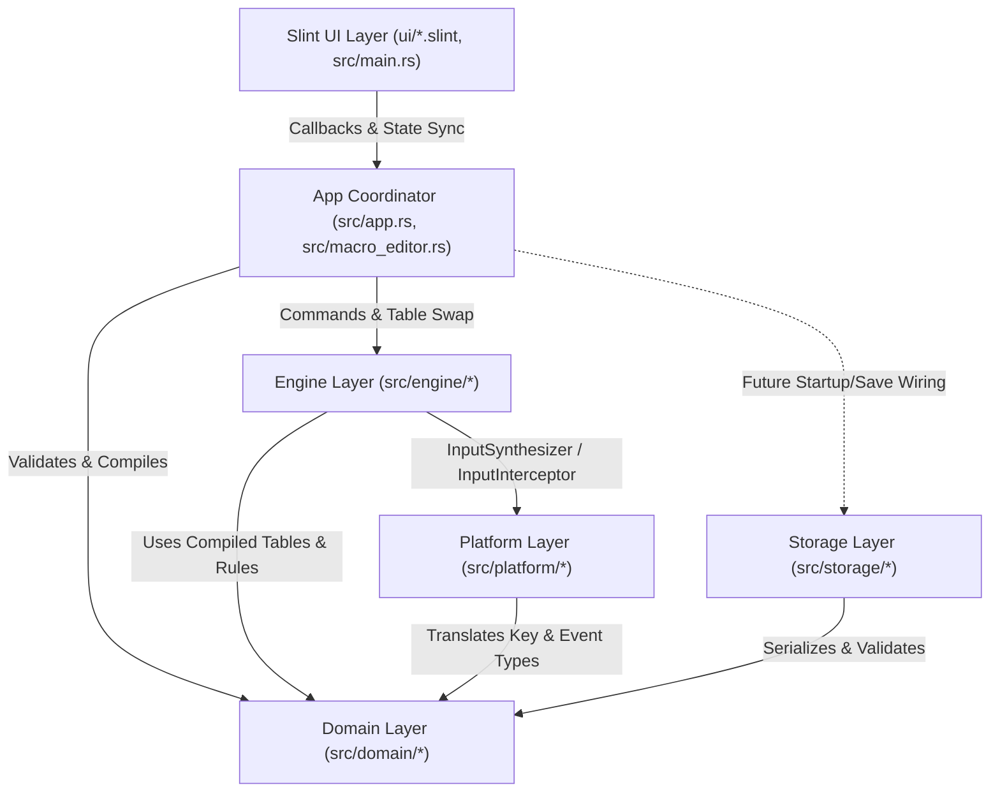
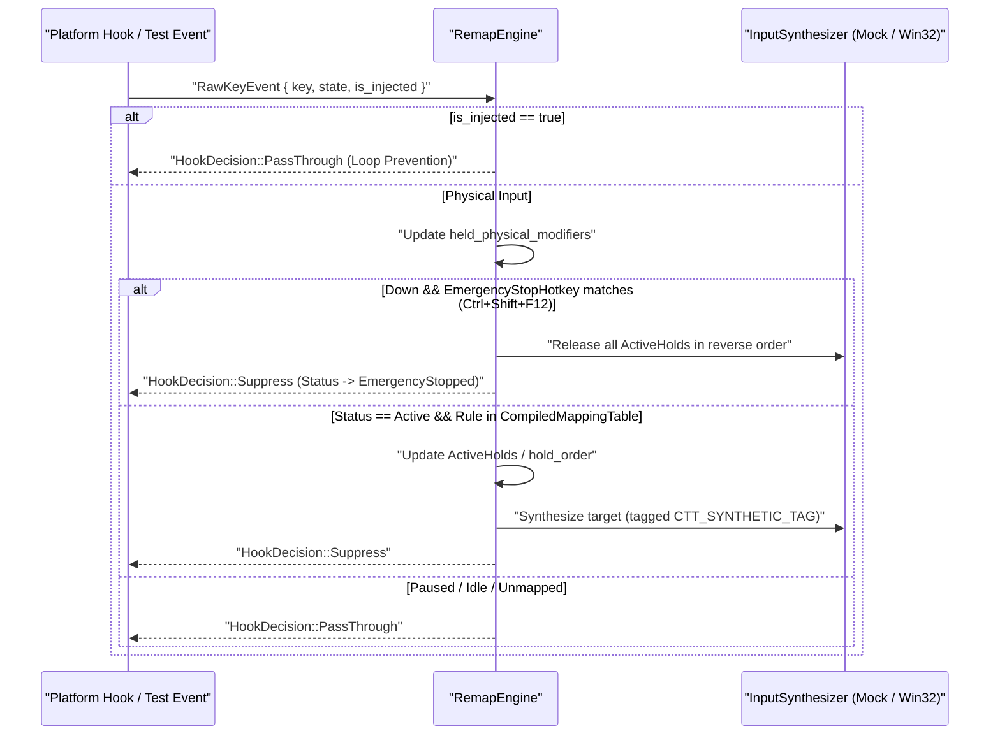

# ctt-app (CTT Project)

A native Windows desktop utility built with **Rust** and **Slint** for gaming-style peripheral key remapping, mouse button binding, and multi-track NLE (Non-Linear Editor) macro sequence design.

---

## 1. Project Overview

**`ctt-app`** (window title: **`CTT Project`**, `v0.1.0`) is a desktop automation and input-remapping application designed as a lightweight, vendor-neutral alternative to proprietary gaming keyboard/mouse driver software.

### What It Solves
- **Unified Peripheral Remapping**: Allows any standard keyboard key or mouse button to be remapped to another key, modifier chord, mouse button, mouse scroll wheel direction, or disabled state within isolated profiles.
- **Visual Multi-Track Macro Authoring**: Replaces flat delay lists with a timeline-based Non-Linear Editor (NLE) supporting simultaneous overlapping key/mouse holds across parallel tracks, magnetic snapping, razor splitting, loop regions, and text sequence import/export.
- **OS-Input Safety First**: Enforces strict runtime safety invariants—starting in a `Paused` state requiring explicit activation, tracking virtual pressed inputs for reverse-order release on pause/profile-switch/emergency-stop, isolating self-synthesized input via `CTT_SYNTHETIC_TAG`, and protecting the emergency stop trigger (`Ctrl + Shift + F12`) from being disabled or hijacked.

### Current Development Status
**Stage 1 / Milestone 1 Completed (Core Architecture, Domain, Engine, Atomic Storage & Slint UI)**

- The layered Rust architecture (`ui` / `app` / `macro_editor`, `domain`, `engine`, `platform`, `storage`), declarative Slint UI (`Tổng quan`, `Macros`, `Binding`, and persistent `StatusBar`), Multi-Track NLE Macro Studio, `import.md` macro text parser/exporter, `RemapEngine` state machine, Win32 keymap translation table, and schema-versioned atomic `ProfileStore` are implemented and backed by unit and integration tests.
- Live Windows low-level hook installation (`SetWindowsHookExW`) and OS input injection (`SendInput`) FFI backends are **not yet wired** (`ADR-003` remains `TBD`); the running UI currently executes against `MockInputSynthesizer` and stores session profiles in memory.

---

## 2. Features

### Completed (Implemented in Source)
- **Profile Management ([`src/app.rs`](src/app.rs), [`src/domain/profile.rs`](src/domain/profile.rs), [`ui/components/home.slint`](ui/components/home.slint))**:
  - Starts safely with zero profiles (`"Chưa có profile"`), gating key binding and macro saving until at least one profile is created.
  - Supports creating (`Profile 1`, `Profile 2`, ...), switching, and deleting profiles. Switching or deleting the last profile releases held virtual outputs and resets the compiled engine lookup table.
- **Key & Mouse Binding System ([`src/domain/keys.rs`](src/domain/keys.rs), [`src/domain/mapping.rs`](src/domain/mapping.rs), [`ui/components/binding_view.slint`](ui/components/binding_view.slint))**:
  - Supports **128 standard physical sources** (`123` standard keyboard keys in `KeyboardKey::ALL_STANDARD` + `5` mouse buttons in `MouseButton::ALL`), plus `KeyboardKey::OemScanCode(ScanCode)` in domain models.
  - Maps any source to 5 `MappingTarget` variants: single `Keyboard` key, `KeyCombo` (`Ctrl` / `Shift` / `Alt` / `Win` modifiers + key), `MouseButton` (`Left`, `Right`, `Middle`, `XButton1`, `XButton2`), `MouseWheel` (`ScrollUp`, `ScrollDown`, `ScrollLeft`, `ScrollRight`), or `Disabled`.
- **Conflict & Safety Validation ([`src/domain/validation.rs`](src/domain/validation.rs))**:
  - Distinguishes blocking `MappingError`s (`NoActiveProfile`, `DuplicateSourceKey`, `ReservedEmergencyStopKey`, `EmptyRuleLabel`) from advisory `MappingWarning`s (`IdentityMapping`, `KeySwapDetected`, `ChainedMappingDetected`).
- **`O(1)` Remapping Runtime Engine ([`src/engine/remapper.rs`](src/engine/remapper.rs), [`src/engine/command.rs`](src/engine/command.rs))**:
  - Evaluates compiled lookup tables (`CompiledMappingTable`) in `O(1)` expected time across `Idle`, `Active`, `Paused`, and `EmergencyStopped` states.
  - Tracks `ActiveHolds` in `hold_order` to emit matching `Up` events in reverse press order on pause, profile switch, or emergency stop.
  - Suppresses auto-repeat `MouseDown` spam while a mapped mouse button is held, ignores injected events (`is_injected`) to prevent infinite loops, and prioritizes `EmergencyStopHotkey` (`Ctrl + Shift + F12` by default) ahead of all rules.
- **Multi-Track NLE Macro Studio ([`src/macro_editor.rs`](src/macro_editor.rs), [`src/domain/macros.rs`](src/domain/macros.rs), [`ui/components/macros_view.slint`](ui/components/macros_view.slint))**:
  - Interactive timeline canvas (up to `600,000 ms` / 10 minutes across `4+` tracks `T1..Tn`) supporting drag-to-move, `6 px` edge trimming, razor splitting, marquee multi-selection, `8 px` magnetic snapping (temporarily bypassable with `Alt`), zoom/fit, loop region (`I` / `O`), and `100`-step undo/redo history.
  - Single-clip and multi-clip inspector, overlap resolution, trigger hotkey capture (excluding `Left`/`Right` mouse clicks), playback modes (`HoldLoop`, `ToggleLoop`, `RunOnce`, `RepeatCount(n)`), 60 FPS preview playback and live canvas key recording, and compilation into ordered `MacroStep` events (`KeyDown`, `KeyUp`, `MouseDown`, `MouseUp`, `Wait`, `LoopStart`, `LoopEnd`).
- **Macro Text Sequence Import & Export ([`src/domain/macro_io.rs`](src/domain/macro_io.rs), [`ui/components/macro_io_modal.slint`](ui/components/macro_io_modal.slint))**:
  - Bidirectional parser and exporter supporting text command sequences (`{CTRL}`, `{SHIFT}`, `{ALT}`, `{LWIN}`, `{WAITMS:...}`, `{HOLDMS:...}`, `{PRESS}`, `{RELEASE}`, `{LMB}`, `{LMBD}`, `{LMBU}`, `{RMB}`, `{MMB}`, `{MB4}`, `{MB5}`, `{SC:0x..}`, `{SCE:0x..}`, named special keys, and system tag pass-through warnings) with greedy multi-track allocation and replace/append modes.
- **Schema-Versioned Atomic Persistence ([`src/storage/profile_store.rs`](src/storage/profile_store.rs), [`src/storage/error.rs`](src/storage/error.rs))**:
  - Serializes `Profile` metadata, `KeyBindingRule` entries, and multi-track `MacroDefinition` items (`CURRENT_SCHEMA_VERSION = 1`) and writes atomically via a sibling `.tmp` file, `File::sync_all()`, and `fs::rename()`.
- **Win32 Keymap & Synthetic Tagging Scaffolding ([`src/platform/windows/`](src/platform/windows/))**:
  - Complete bidirectional Win32 `vk` / `scan_code` / `extended` translation for all `123` `KeyboardKey::ALL_STANDARD` entries and `Win32InputPacket` construction stamped with `CTT_SYNTHETIC_TAG` (`0x4354_545F_5359_4E54`).

### Partially Implemented
- **Windows OS Hook & `SendInput` Adapter ([`src/platform/windows/hook.rs`](src/platform/windows/hook.rs), [`src/platform/windows/synth.rs`](src/platform/windows/synth.rs))**:
  - `WindowsKeyboardHook` (with RAII `Drop` cleanup) and `WindowsInputSynthesizer` types exist, but `start()` returns `Err(PlatformError::HookRegistrationFailed(...))` and `synthesize()` returns `Err(PlatformError::UnsupportedPlatform)`. `CttApp` currently wires `MockInputSynthesizer`.
- **Disk Persistence Wiring in `CttApp` ([`src/app.rs`](src/app.rs), [`src/domain/config.rs`](src/domain/config.rs))**:
  - `ProfileStore` and `AppConfig` are implemented and unit-tested, but `CttApp` does not yet automatically load profiles/config from disk at startup or flush profile edits to disk on change.

### Planned (Not Yet Implemented)
- Live Win32 FFI input hook (`WH_KEYBOARD_LL` / `WH_MOUSE_LL`) and `SendInput` backend (`ADR-003`).
- Background macro playback worker thread executing compiled `MacroStep` timings against the OS input synthesizer.
- Structured logging/diagnostics panel (`ADR-005`), system tray minimization, and Windows UIPI elevation strategy (`ADR-006`).

---

## 3. Technology Stack

| Category | Technology / Crate | Version / Details | Source |
| :--- | :--- | :--- | :--- |
| **Language** | Rust | Edition `2021` | [`Cargo.toml`](Cargo.toml) |
| **Build & Package Manager** | Cargo | Standard workspace build + [`build.rs`](build.rs) | [`Cargo.toml`](Cargo.toml) |
| **Desktop GUI Framework** | `slint` | `1.19` (declarative `.slint` views) | [`Cargo.toml`](Cargo.toml) |
| **UI Build Compiler** | `slint-build` | `1.19` (compiles [`ui/app.slint`](ui/app.slint)) | [`build.rs`](build.rs) |
| **Release Profile** | Cargo `[profile.release]` | `opt-level = 3`, `lto = "thin"`, `codegen-units = 1`, `strip = true` | [`Cargo.toml`](Cargo.toml) |
| **Target Platform** | Windows x64 (`x86_64-pc-windows-msvc`) | Uses `windows_subsystem = "windows"` in release builds | [`src/main.rs`](src/main.rs), [`build_release.bat`](build_release.bat) |
| **Packaging Tooling** | Windows Batch + PowerShell | Portable folder & ZIP packager (`Compress-Archive`) | [`build_release.bat`](build_release.bat) |
| **External Services / DB** | None | Local desktop app; no database, network API, or telemetry | — |
| **Undecided Crates (`TBD`)** | OS FFI / Serialization / Logging / Tray | Pending `ADR-003`, `ADR-004`, `ADR-005`, `ADR-006` | [`DECISIONS.md`](DECISIONS.md) |

---

## 4. Project Structure

```text
ctt-app/
├── .agents/                    # AI agent operating rules and specialized workflow skills
│   ├── rules/                  # Architecture, global, key-mapping, macro-system, and UI/UX rules
│   └── skills/                 # Modular agent skill instructions
├── .cargo/
│   └── config.toml             # Machine-local Cargo target-dir configuration
├── prototypes/
│   └── HomePage.png            # UI design prototype reference
├── src/
│   ├── main.rs                 # Binary entry point, Slint callbacks, 60 FPS macro animation timer
│   ├── lib.rs                  # Crate library root exporting all public modules
│   ├── app.rs                  # CttApp coordinator bridging Slint state, domain profiles, and RemapEngine
│   ├── macro_editor.rs         # Stateful Multi-Track NLE Macro Studio controller & canvas projections
│   ├── domain/                 # Pure business models, rules, validation, and compilers (no UI/OS I/O)
│   │   ├── mod.rs
│   │   ├── config.rs           # AppConfig, EmergencyStopHotkey, CURRENT_SCHEMA_VERSION
│   │   ├── keys.rs             # ScanCode, KeyState, ModifierMask, MouseButton, MouseWheel, 123 KeyboardKeys
│   │   ├── mapping.rs          # MappingTarget, KeyBindingRule, CompiledMappingTable (O(1) lookup)
│   │   ├── validation.rs       # Blocking MappingError and advisory MappingWarning validators
│   │   ├── profile.rs          # Profile model with rule/macro CRUD and compilation helpers
│   │   ├── macros.rs           # Clip, LoopRegion, MacroDefinition, MacroStep, timeline & compiler logic
│   │   └── macro_io.rs         # import.md macro text parser and exporter
│   ├── engine/                 # Runtime input remapping state machine
│   │   ├── mod.rs
│   │   ├── command.rs          # EngineStatus, EngineCommand, EngineSnapshot
│   │   └── remapper.rs         # RemapEngine (dispatch, ActiveHolds, auto-repeat, emergency stop)
│   ├── platform/               # OS abstractions, test mocks, and Windows keymap/hook scaffolding
│   │   ├── mod.rs              # InputSynthesizer, InputInterceptor, CTT_SYNTHETIC_TAG, raw event types
│   │   ├── mock.rs             # MockInputSynthesizer for deterministic non-OS tests
│   │   └── windows/
│   │       ├── mod.rs
│   │       ├── hook.rs         # WindowsKeyboardHook RAII scaffolding & dwExtraInfo tag check
│   │       ├── keymap.rs       # Bidirectional Win32 VK/scancode <-> KeyboardKey lookup table
│   │       └── synth.rs        # Win32InputPacket builder & WindowsInputSynthesizer stub
│   └── storage/                # Schema-versioned atomic profile persistence
│       ├── mod.rs
│       ├── error.rs            # StorageError enum
│       └── profile_store.rs    # ProfileStore serializer, validator, and atomic temp+sync+rename writer
├── tests/
│   ├── key_mapping_domain_tests.rs  # Domain, Win32 keymap round-trip, validation, and storage tests
│   └── remap_engine_tests.rs        # RemapEngine behavior, hold release, and loop-prevention tests
├── ui/
│   ├── app.slint               # Root AppWindow shell, sidebar navigation, properties, callbacks
│   └── components/
│       ├── home.slint          # Overview tab ("Tổng quan"): profile selector & binding summary table
│       ├── binding_view.slint  # Binding tab: source/target editor, modifiers, rule list, validation banners
│       ├── macros_view.slint   # Macros tab: saved list + dark-studio Multi-Track NLE timeline & inspector
│       ├── macro_io_modal.slint# Modal for import.md text macro import/export & live validation
│       └── status_bar.slint    # Persistent bottom bar: status badge, Panic label, Kích hoạt/Tạm dừng, Stop All
├── build.rs                    # Compiles ui/app.slint via slint-build
├── build_release.bat           # Windows release test, compile, portable dist packaging, and ZIP script
├── Cargo.toml                  # Rust crate manifest
├── Cargo.lock                  # Locked dependency graph
├── AGENTS.md                   # AI agent operating guidelines
├── ARCHITECTURE.md             # Implemented vs. target architecture reference
├── DECISIONS.md                # Architectural Decision Records (ADR-001 through ADR-006)
├── DEVELOPMENT_GUIDE.md        # Toolchain and coding conventions
├── PROJECT_CONTEXT.md          # Scope, status, and platform constraints
├── ROADMAP.md                  # Milestone history and planned phases
├── USER_WORKFLOW.md            # Detailed user & runtime workflow guide (Vietnamese)
└── README.md                   # This document
```

*(Generated directories `/target` and `/dist` are ignored by [`.gitignore`](.gitignore).)*

---

## 5. Architecture Overview

`ctt-app` enforces a strict layered architecture so domain invariants and runtime state transitions remain deterministic and testable without launching GUI windows or installing live OS hooks.

### Module Layers & Dependency Flow



### Layer Responsibilities

| Layer | Location | Responsibility | Forbidden Dependencies |
| :--- | :--- | :--- | :--- |
| **UI & Coordinator** | [`ui/`](ui/), [`src/main.rs`](src/main.rs), [`src/app.rs`](src/app.rs), [`src/macro_editor.rs`](src/macro_editor.rs) | Slint views, event callbacks, 60 FPS macro animation timer, view projections (`UiClipItem`, `DomainRuleView`, etc.). | Direct Win32 hook FFI, blocking disk I/O in render loops. |
| **Domain** | [`src/domain/`](src/domain/) | Pure Rust models (`KeyboardKey`, `Profile`, `MacroDefinition`), `CompiledMappingTable`, rule validation, timeline compilation, `import.md` parser. | `slint`, OS APIs, filesystem I/O. |
| **Engine** | [`src/engine/`](src/engine/) | `RemapEngine` state machine, `ActiveHolds` tracking, auto-repeat suppression, synthetic event filtering, emergency stop cleanup. | `slint`, filesystem I/O. |
| **Platform** | [`src/platform/`](src/platform/) | `InputSynthesizer` / `InputInterceptor` traits, `MockInputSynthesizer`, Win32 keymap table, `CTT_SYNTHETIC_TAG` packet builders. | UI state, config persistence. |
| **Storage** | [`src/storage/`](src/storage/) | Schema-versioned serialization (`ProfileStore`), validation on load, atomic sibling temp-file + `sync_all` + rename writes. | `slint`, OS hooks. |

### Runtime Key Evaluation & Safety Flow



---

## 6. Installation and Setup

### Prerequisites
- **Rust Toolchain**: Stable Rust (`2021` edition) with `cargo`, `clippy`, and `rustfmt` installed via [rustup](https://rustup.rs/).
- **Windows C++ Build Tools**: Visual Studio Build Tools (Desktop development with C++ workload and Windows SDK) for the `x86_64-pc-windows-msvc` target and Slint native backend compilation.
- **Git**: For cloning the repository.
- **PowerShell**: Available by default on Windows (used by [`build_release.bat`](build_release.bat) for metadata resolution and ZIP compression).

### Clone & Verify Toolchain

```powershell
git clone https://github.com/giang1132006/ctt-app.git
cd ctt-app

rustc --version
cargo --version
```

### Environment & Cargo Configuration
- **No environment secrets or `.env` files** are required.
- **Note on [`.cargo/config.toml`](.cargo/config.toml)**: The repository currently contains:
  ```toml
  [build]
  target-dir = "C:/Users/legia/.cargo-targets/ctt-app"
  ```
  If that path does not match your local machine or user directory, either override it in your shell before running Cargo or edit your local Cargo configuration:
  ```powershell
  # PowerShell session override to use the standard ./target directory
  $env:CARGO_TARGET_DIR = "$PWD\target"
  ```

---

## 7. Running the Project

All commands are run from the repository root (`ctt-app/`):

### Development Mode

```powershell
# Verify compilation (including build.rs compiling ui/app.slint)
cargo check

# Build and launch the Slint desktop application
cargo run
```

### Automated Tests, Linting & Formatting

```powershell
# Run all unit and integration tests (uses MockInputSynthesizer; emits no live OS input)
cargo test

# Run tests across all targets (library, binary, and integration tests)
cargo test --all-targets

# Run Clippy linter checks
cargo clippy --all-targets

# Check formatting against rustfmt rules
cargo fmt --check
```

### Production Build & Portable Windows Packaging

```powershell
# Build optimized release executable (hides Windows console window via windows_subsystem = "windows")
cargo build --release
```

To build, test, and package a portable Windows x64 distribution automatically, run [`build_release.bat`](build_release.bat):

```powershell
# Full verification + release build + portable ZIP (interactive pause at end)
.\build_release.bat

# Non-interactive CI/scripted run (skips pause)
.\build_release.bat --no-pause

# Skip cargo test --all-targets and package immediately
.\build_release.bat --skip-tests --no-pause
```

[`build_release.bat`](build_release.bat) produces:
- `dist\ctt-app\ctt-app.exe`
- `dist\ctt-app\profiles\`
- `dist\ctt-app\HUONG_DAN_SU_DUNG.txt`
- `dist\ctt-app-windows-x64.zip`

---

## 8. Usage Guide

> **Note**: The application UI labels are currently written in Vietnamese. Because live Win32 hooks (`ADR-003`) are not yet connected, key remapping currently updates the internal `RemapEngine` state machine (`MockInputSynthesizer`) rather than intercepting live host OS keystrokes.

### 1. Create and Manage Profiles (**`Tổng quan`** Tab)
1. Launch the app (`cargo run`). The app starts with **zero profiles** (`"Chưa có profile"`) and the engine in **`Paused`** mode.
2. Click **`Tạo mới`** to create a profile (`Profile 1`, `Profile 2`, ...).
3. Use the profile dropdown to switch between profiles or **`Xoá profile`** to delete the active profile.
   - Switching profiles automatically calls `release_all_holds` before installing the new profile's `CompiledMappingTable`.
   - Deleting the final profile returns the app to the gated empty state and pauses an active engine.

### 2. Configure Key & Mouse Bindings (**`Binding`** Tab)
1. Select a **`Phím nguồn`** from the 128-entry catalog (`MouseButton::ALL` + `KeyboardKey::ALL_STANDARD`).
2. Choose one of 5 target types:
   - **`Phím`** (`Keyboard`): Single target key.
   - **`Tổ hợp phím`** (`KeyCombo`): Toggle `Ctrl`, `Shift`, `Alt`, `Win` modifiers + target key.
   - **`Nút chuột`** (`MouseButton`): `Mouse Left`, `Mouse Right`, `Mouse Middle`, `Mouse Back (X1)`, `Mouse Forward (X2)`.
   - **`Cuộn chuột`** (`MouseWheel`): `Wheel Up`, `Wheel Down`, `Wheel Left`, `Wheel Right`.
   - **`Vô hiệu hoá`** (`Disabled`): Suppresses the source input.
3. Optionally enter a rule description (defaults to `"<Source> → <Target>"` if left blank) and save.
4. Validation feedback appears immediately:
   - **Blocking errors** (prevent saving): Duplicate source key, empty label, or attempting to disable/hijack an unmodified emergency stop trigger (`ReservedEmergencyStopKey`).
   - **Advisory warnings** (allowed with notice): Self-mapping (`IdentityMapping`), two-key swap (`KeySwapDetected`), or chained rule (`ChainedMappingDetected`).

### 3. Design Multi-Track Macros (**`Macros`** Tab)
1. Click **`+ Tạo Macro`** to open the **CTT Macro Studio** multi-track NLE editor.
2. Add actions via toolbar buttons (`+ Phím`, `+ LC`, `+ RC`, `+ Khoảng trống`) or double-click a track lane to insert a key clip at the cursor.
3. Edit clips directly on the timeline:
   - Drag clip body to move time/track (automatically resolves overlaps).
   - Drag clip left/right `6 px` edge handles to trim hold duration (`dur_ms`).
   - Hold `Alt` while dragging to bypass `8 px` magnetic snapping; `Ctrl + Mouse Wheel` to zoom.
   - Use the **Ghi (`●`)** toolbar button for live keyboard capture into tracks, or **Xem thử** (`Space`) for 60 FPS playhead preview.
4. Set an optional trigger hotkey (keyboard key or `M3`/`M4` side mouse buttons; `LC`/`RC` are blocked for safety) and playback mode (`Hold`, `Toggle`, `Once`), then save the macro into the active profile.

#### Macro Timeline Keyboard Shortcuts ([`src/macro_editor.rs`](src/macro_editor.rs))

| Shortcut | Action |
| :--- | :--- |
| `Space` | Toggle 60 FPS timeline preview playback |
| `C` | Razor split clip(s) at playhead |
| `I` / `O` | Set Loop Region In / Out point at playhead |
| `Delete` / `Backspace` | Delete selected clips |
| `Left` / `Right` | Nudge selected clips (or playhead) by `1 ms` (`10 ms` with `Shift`) |
| `Up` / `Down` | Move selected clips across tracks (`T1..Tn`) |
| `Home` / `End` | Jump playhead to `0 ms` or timeline content end |
| `+` (`=`) / `-` | Zoom timeline in / out |
| `Ctrl + Z` / `Ctrl + Y` | Undo / Redo (up to 100 snapshots) |
| `Ctrl + X` / `Ctrl + C` / `Ctrl + V` | Cut / Copy / Paste clips at playhead |
| `Ctrl + D` / `Ctrl + A` | Duplicate selected / Select all clips |
| `Ctrl + S` | Save current macro to active profile |
| `Escape` | Cancel key capture, hotkey capture, or clear selection |

#### Text Macro Import / Export Example (**`Import / Export`** Modal)
Click **`Import / Export`** in the Macro Studio to paste or export text sequences:

```text
{CTRL}{HOLDMS:100}c{WAITMS:50}{LMBD}{WAITMS:120}{LMBU}
```

Supported syntax highlights ([`src/domain/macro_io.rs`](src/domain/macro_io.rs)):
- Modifiers: `{CTRL}`, `{RCTRL}`, `{SHIFT}`, `{RSHIFT}`, `{ALT}`, `{RALT}`, `{LWIN}`, `{RWIN}`
- Timing: `{WAITMS:n}` / `{WAITMSn}` / `{WAIT:sec}`, `{HOLDMS:n}` / `{HOLDMSn}` / `{HOLD:sec}` (ranges like `{WAITMS:40-80}` average to `60 ms` with an import note)
- Explicit hold pairs: `{PRESS}` / `{RELEASE}` followed by a key, or mouse hold tags `{LMBD}`/`{LMBU}`, `{RMBD}`/`{RMBU}`, `{MMBD}`/`{MMBU}`, `{MB4D}`/`{MB4U}`, `{MB5D}`/`{MB5U}`
- Mouse taps: `{LMB}`, `{RMB}`, `{MMB}`, `{MB4}`, `{MB5}`
- Low-level scan codes / virtual keys: `{SC:0x..}`, `{SCE:0x..}`, `{VKC:0x..}`, `{EXT:0x..}`

### 4. Activate Engine & Emergency Stop (**`StatusBar`**)
- Click **`Kích hoạt`** to transition the engine from `Paused` to `Active` (or `Idle` if the profile has no active rules).
- Click **`Tạm dừng`** to release all held virtual outputs and return to `Paused`.
- Click **`Stop All`** (red button) or trigger **`Ctrl + Shift + F12`** at any time to immediately cancel active macro recording/preview, release all held virtual keys/buttons in reverse order, and enter `EmergencyStopped`.

---

## 9. Development Guide

### Architectural Conventions
- **Rust Edition**: `2021`.
- **Strong Typing**: Use explicit domain types (`KeyboardKey`, `ScanCode`, `MouseButton`, `MacroId`, `ModifierMask`, `MappingTarget`) instead of raw integers or untyped strings.
- **No Unchecked Panics in Runtime Paths**: Propagate typed errors (`MappingError`, `PlatformError`, `StorageError`) via `Result`; avoid `.unwrap()`/`.expect()` in production runtime, UI callbacks, or hook evaluation paths.
- **Strict Boundary Isolation**:
  - Keep [`src/domain/`](src/domain/) free of `slint`, OS APIs, and filesystem I/O.
  - Keep [`src/platform/`](src/platform/) free of UI state and disk storage.
  - Never synthesize live OS inputs inside `cargo test`—always test [`RemapEngine`](src/engine/remapper.rs) against [`MockInputSynthesizer`](src/platform/mock.rs).

### Key Modules for Contributors
- Adding input sources or targets: [`src/domain/keys.rs`](src/domain/keys.rs), [`src/domain/mapping.rs`](src/domain/mapping.rs), and [`src/platform/windows/keymap.rs`](src/platform/windows/keymap.rs).
- Modifying remap behavior or hold-release safety: [`src/engine/remapper.rs`](src/engine/remapper.rs) and [`tests/remap_engine_tests.rs`](tests/remap_engine_tests.rs).
- Extending the NLE macro editor or `import.md` grammar: [`src/domain/macros.rs`](src/domain/macros.rs), [`src/domain/macro_io.rs`](src/domain/macro_io.rs), [`src/macro_editor.rs`](src/macro_editor.rs), and [`ui/components/macros_view.slint`](ui/components/macros_view.slint).
- Implementing live Windows hooks & `SendInput`: [`DECISIONS.md`](DECISIONS.md) (`ADR-003`), [`src/platform/windows/hook.rs`](src/platform/windows/hook.rs), and [`src/platform/windows/synth.rs`](src/platform/windows/synth.rs).
- Reviewing AI-assisted workflow standards: [`AGENTS.md`](AGENTS.md) and [`.agents/rules/`](.agents/rules/).

---

## 10. Known Issues and Limitations

1. **No Live OS Input Interception or Injection Yet**: [`WindowsKeyboardHook::start`](src/platform/windows/hook.rs) and [`WindowsInputSynthesizer::synthesize`](src/platform/windows/synth.rs) are currently stubs (`ADR-003` is `TBD`). [`CttApp`](src/app.rs) instantiates `MockInputSynthesizer`, so bindings do not yet alter real OS input outside the app.
2. **Macro Playback Engine Not Wired to OS Thread**: Macros can be authored, validated, previewed visually on the timeline at 60 FPS, compiled to `MacroStep` sequences, and serialized, but background multi-threaded OS macro execution when pressing a saved macro hotkey is not yet implemented.
3. **In-Memory Runtime Profiles**: [`ProfileStore`](src/storage/profile_store.rs) implements atomic save/load and passes tests, and [`AppConfig`](src/domain/config.rs) defines top-level settings, but [`CttApp`](src/app.rs) does not yet persist or reload profiles automatically across restarts.
4. **Hardcoded Local `target-dir`**: [`.cargo/config.toml`](.cargo/config.toml) sets `target-dir = "C:/Users/legia/.cargo-targets/ctt-app"`, which assumes that Windows user path unless overridden via `CARGO_TARGET_DIR`.
5. **Windows UIPI / Elevation Boundary**: Once live `SendInput` / hooks are connected, non-elevated processes on Windows cannot inject input into elevated (Administrator) applications without running as administrator or UIAccess.
6. **Legacy References in Secondary Docs**: A few older sections in [`AGENTS.md`](AGENTS.md), [`DEVELOPMENT_GUIDE.md`](DEVELOPMENT_GUIDE.md), [`ARCHITECTURE.md`](ARCHITECTURE.md), and [`USER_WORKFLOW.md`](USER_WORKFLOW.md) still contain pre-migration references to `eframe`/`egui` or initial default sample profiles. The authoritative source of truth is `Cargo.toml`, `ui/*.slint`, and `src/*.rs`.

---

## 11. Roadmap

Tracked in [`ROADMAP.md`](ROADMAP.md) and [`DECISIONS.md`](DECISIONS.md):

- **Completed**:
  - **M0.1–M0.3**: Repository initialization, Rust + Slint (`1.19`) scaffold, and AI Agent Operating System setup.
  - **M1**: 4-layer key binding domain (`123` standard keys + mouse inputs), `RemapEngine`, `MockInputSynthesizer`, Win32 keymap & packet tagging scaffolding, atomic `ProfileStore`, Slint `BindingView` / `StatusBar`, plus Multi-Track NLE Macro Studio (`src/macro_editor.rs`, `src/domain/macros.rs`, `src/domain/macro_io.rs`).
- **Upcoming / Open Decisions**:
  - **Milestone 2 (Persistence Integration)**: Finalize serialization/storage directory policy (`ADR-004`), structured logging strategy (`ADR-005`), and wire `ProfileStore` + `AppConfig` load/save into `CttApp`.
  - **Milestone 3 (Live OS Platform Backend)**: Decide OS input backend (`ADR-003`: direct Win32 `windows`/`windows-sys` vs. cross-platform crates) and implement non-blocking `WH_KEYBOARD_LL`/`WH_MOUSE_LL` hooks, `SendInput` with `CTT_SYNTHETIC_TAG`, and RAII cleanup.
  - **Milestone 5 (Background Macro Playback Engine)**: Add interruptible background worker thread executing compiled `MacroStep` sequences with monotonic timing and guaranteed `Up` release on stop/cancel.
  - **Milestone 6 (Desktop Polish & Release Readiness)**: Decide system tray behavior and elevation policy (`ADR-006`).

---

## 12. License

No `LICENSE` file or `license` metadata field in [`Cargo.toml`](Cargo.toml) is currently declared in this repository. All rights remain reserved by the repository author until an explicit license is added.
