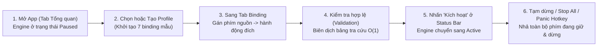
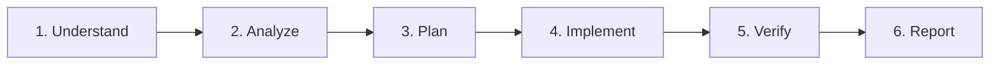
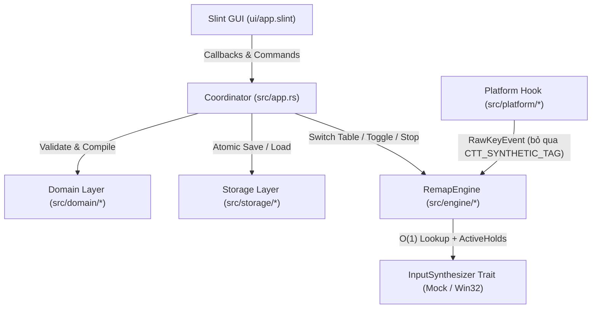

# `ctt-app` — Workflow & Hướng Dẫn Luồng Sử Dụng

Tài liệu này tổng hợp đầy đủ hai phần:
1. **Luồng sử dụng ứng dụng (`User Workflow`)**: Từ khởi động, quản lý Profile, gán phím (Binding) đến cơ chế kích hoạt và các nút dừng khẩn cấp.
2. **Luồng kiến trúc, phát triển và kiểm thử (`Development & Runtime Workflow`)**: Quy trình 6 bước, kiến trúc 4 lớp và các lệnh Cargo tiêu chuẩn.

---

## Phần 1: Luồng Sử Dụng Ứng Dụng (User Workflow)



### 1.1. Công đoạn Quản lý Profile (Tab **Tổng quan**)
Được cài đặt tại [ui/components/home.slint](ui/components/home.slint), [src/app.rs](src/app.rs) và [src/domain/profile.rs](src/domain/profile.rs).

Khi mở ứng dụng hoặc nhấn nút **`Tạo mới`**, một Profile sẽ bao gồm:
- **Thông tin định danh**:
  - `id` tự tăng, tên hiển thị (mặc định là `"Profile mặc định"`, khi bấm **`Tạo mới`** sẽ tạo `"Profile 2"`, `"Profile 3"`, ...).
  - `schema_version` (phục vụ lưu trữ bền vững ở [src/storage/profile_store.rs](src/storage/profile_store.rs)) và cờ `enabled: true`.
- **7 bộ Binding mẫu có sẵn** (sử dụng các phím `F13` $\rightarrow$ `F19` để tránh đè lên phím gõ thông thường):
  1. `F13` $\rightarrow$ `Ctrl + N` (*Tạo mới*)
  2. `F14` $\rightarrow$ `Ctrl + O` (*Mở*)
  3. `F15` $\rightarrow$ `Ctrl + S` (*Lưu*)
  4. `F16` $\rightarrow$ `Ctrl + C` (*Sao chép*)
  5. `F17` $\rightarrow$ `Ctrl + V` (*Dán*)
  6. `F18` $\rightarrow$ `Ctrl + Z` (*Hoàn tác*)
  7. `F19` $\rightarrow$ `Ctrl + Y` (*Làm lại*)
- **Các thao tác với Profile**:
  - **Chọn Profile (Dropdown)**: Khi chuyển sang profile khác, `RemapEngine` tự động **nhả (release) toàn bộ các phím/chuột ảo đang được giữ** của profile cũ trước khi nạp bảng tra cứu mới ([src/engine/remapper.rs](src/engine/remapper.rs)).
  - **Nút `Xoá profile`**: Xoá profile đang chọn. Nếu chỉ còn duy nhất 1 profile cuối cùng, ứng dụng **không để danh sách rỗng** mà sẽ reset về `"Profile mặc định"` ban đầu ([src/app.rs](src/app.rs)).

---

### 1.2. Công đoạn Bind Phím (Tab **Binding**)
Được cài đặt tại [ui/components/binding_view.slint](ui/components/binding_view.slint) và xử lý tại [src/app.rs](src/app.rs).

Quy trình thao tác trên giao diện:
1. **Chọn `Phím nguồn`**: Chọn từ danh sách **123 phím chuẩn** (`KeyboardKey::ALL_STANDARD`).
2. **Chọn `Loại đích`** (5 chế độ `MappingTarget`):
   - **`Phím` (`Keyboard`)**: Đổi 1 phím sang 1 phím đơn khác.
   - **`Tổ hợp phím` (`KeyCombo`)**: Bật/tắt các modifier (`Ctrl`, `Shift`, `Alt`, `Win`) kết hợp với 1 phím đích.
   - **`Nút chuột` (`MouseButton`)**: Gán phím bàn phím thành nút chuột. Khi giữ phím, engine giữ nguyên trạng thái nhấn chuột và chặn auto-repeat để không spam `MouseDown` ([src/engine/remapper.rs](src/engine/remapper.rs)).
   - **`Cuộn chuột` (`MouseWheel`)**: Gán phím thành thao tác cuộn chuột (với độ chia chuẩn `DEFAULT_WHEEL_DELTA = 120`).
   - **`Vô hiệu hoá` (`Disabled`)**: Chặn/vô hiệu hoá phím nguồn.
3. **Nhập `Mô tả`** *(tuỳ chọn)*: Nếu để trống, ứng dụng tự tạo mô tả theo mẫu `"<Phím nguồn> → <Hành động đích>"`.
4. **Nhấn `Lưu Binding`**:
   - Nếu phím nguồn đã tồn tại trong profile, quy tắc sẽ được **cập nhật đè tại chỗ**; nếu chưa có thì thêm mới (`set_or_add_binding`).
   - **Kiểm tra an toàn ([src/domain/validation.rs](src/domain/validation.rs))**:
     - **Lỗi chặn lưu (`MappingError` - khung đỏ)**: Trùng phím nguồn (`DuplicateSourceKey`), nhãn rỗng (`EmptyRuleLabel`), hoặc vô hiệu hoá / chiếm quyền phím Emergency Stop (`ReservedEmergencyStopKey`).
     - **Cảnh báo (`MappingWarning` - khung vàng, vẫn cho lưu)**: Gán phím vào chính nó (`IdentityMapping`), hoán đổi hai phím (`KeySwapDetected`), hoặc chuỗi gán nối tiếp (`ChainedMappingDetected` — chỉ nhấn vật lý mới kích hoạt quy tắc tiếp theo).
   - Sau khi hợp lệ, profile được biên dịch thành `CompiledMappingTable` ($O(1)$ lookup) và đồng bộ xuống `RemapEngine`.
5. **Nút `Xoá` trên từng dòng**: Xoá quy tắc của phím nguồn tương ứng khỏi `Danh sách Binding`.

---

### 1.3. Các Nút Dừng & Điều Khiển Ở Thanh Trạng Thái (`StatusBar`)
Thanh trạng thái nằm cố định ở đáy cửa sổ ([ui/components/status_bar.slint](ui/components/status_bar.slint)), luôn hiển thị ở mọi tab:

| Thành phần trên Status Bar | Trạng thái hiển thị | Chức năng & Cơ chế hoạt động |
| :--- | :--- | :--- |
| **Badge trạng thái** *(bên trái)* | **`Paused`** (Xám)<br>**`Active`** / **`Idle`** (Xanh lá)<br>**`EmergencyStopped`** (Đỏ) | Cho biết trạng thái hiện tại của `RemapEngine`, kèm tên Profile đang chọn và thông báo thao tác gần nhất. |
| **Nút `Kích hoạt` / `Tạm dừng`** | **`Kích hoạt`** (tím) khi dừng;<br>**`Tạm dừng`** (xám) khi đang chạy | - **Khi mới mở app**: Engine mặc định ở **`Paused`** (không tự ý remap). Phải nhấn **`Kích hoạt`** thì bảng binding mới có hiệu lực.<br>- **Khi nhấn `Tạm dừng`**: Gọi `release_all_holds` để nhả toàn bộ phím/chuột ảo đang giữ dở rồi chuyển sang **`Paused`**. |
| **Nút `Stop All`** *(màu đỏ)* | Luôn hiển thị ở góc phải dưới | **Cầu dao ngắt khẩn cấp trên giao diện (`emergency_stop_all`)**:<br>1. Đưa Engine lập tức về **`EmergencyStopped`**.<br>2. Duyệt `active_holds` theo **thứ tự ngược lại với lúc bấm (`hold_order.pop()`)** để nhả toàn bộ phím đơn, modifier (`Ctrl`/`Shift`/`Alt`/`Win`) và nút chuột đang được giữ ảo (chống kẹt phím). |
| **Nhãn `Panic: Ctrl + Shift + F12`** | Luôn hiển thị cạnh nút kích hoạt | **Cầu dao ngắt khẩn cấp bằng bàn phím**:<br>`RemapEngine::handle_key_event` luôn theo dõi modifier vật lý và ưu tiên kiểm tra tổ hợp **`Ctrl + Shift + F12`** trước mọi quy tắc remap để kích hoạt `emergency_stop_all` ngay cả khi cửa sổ app không được focus. |

> **Khôi phục sau Emergency Stop**: Sau khi kích hoạt `Stop All` hoặc `Ctrl + Shift + F12`, engine giữ nguyên trạng thái `EmergencyStopped` cho đến khi người dùng bấm lại **`Kích hoạt`**.

---

## Phần 2: Luồng Kiến Trúc, Phát Triển & Kiểm Thử (Developer Workflow)

### 2.1. Quy trình làm việc 6 pha (Agent & Developer Workflow)
Định nghĩa trong [AGENTS.md](AGENTS.md):



1. **Understand**: Đọc [PROJECT_CONTEXT.md](PROJECT_CONTEXT.md), [ARCHITECTURE.md](ARCHITECTURE.md), [DECISIONS.md](DECISIONS.md), các rule trong `.agents/rules/` và skill trong `.agents/skills/`.
2. **Analyze**: Xác định tầng bị ảnh hưởng (`ui`, `domain`, `engine`, `platform`, `storage`) và các ràng buộc an toàn OS input.
3. **Plan**: Lập kế hoạch mục tiêu, phương án, tệp chỉnh sửa, bước thực hiện, rủi ro (stuck keys, feedback loops, hook timeout) và chiến lược kiểm thử.
4. **Implement**: Viết mã Rust 2021 theo đúng ranh giới kiến trúc (không đặt FFI OS hook hay I/O đĩa trong `domain` hoặc `ui`).
5. **Verify**: Chạy đầy đủ kiểm tra biên dịch, test, lint và format.
6. **Report**: Tổng hợp thay đổi, quyết định kỹ thuật, kết quả kiểm thử và bước tiếp theo.

### 2.2. Kiến trúc 4 tầng & Luồng dữ liệu Runtime
Định nghĩa trong [ARCHITECTURE.md](ARCHITECTURE.md):



- **Chống lặp vô hạn (`Loop Prevention`)**: Mọi sự kiện có cờ `is_injected` (gắn tag `CTT_SYNTHETIC_TAG`) được trả về `HookDecision::PassThrough` ngay lập tức tại đầu hàm `RemapEngine::handle_key_event`.
- **Trạng thái hiện tại ([ROADMAP.md](ROADMAP.md))**: Lớp `domain`, `engine`, `storage`, `MockInputSynthesizer`, bảng keymap Win32 và Slint UI (`Tổng quan`, `Binding`, `StatusBar`) đã được triển khai; phần kết nối Win32 hook FFI trực tiếp (`ADR-003`) và hệ thống ghi/phát Macro là các cột mốc tiếp theo.

### 2.3. Lệnh Build, Test & Verify (Cargo)
Theo [DEVELOPMENT_GUIDE.md](DEVELOPMENT_GUIDE.md):

```powershell
# Kiểm tra biên dịch (bao gồm build.rs biên dịch ui/app.slint)
cargo check

# Chạy toàn bộ unit test và integration test (dùng MockInputSynthesizer, không phát phím thật ra OS)
cargo test

# Kiểm tra linter & chuẩn định dạng
cargo clippy --all-targets
cargo fmt --check

# Chạy ứng dụng desktop
cargo run
```
